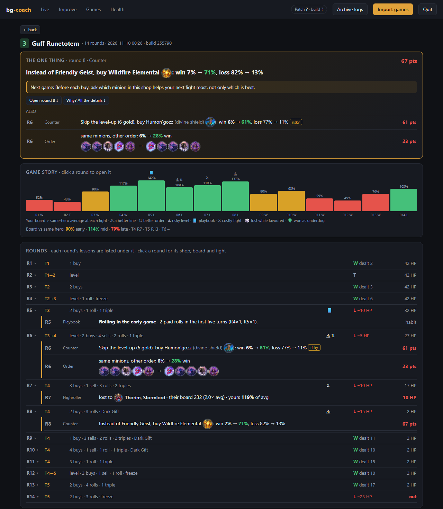
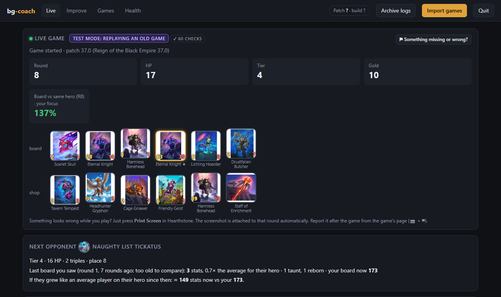
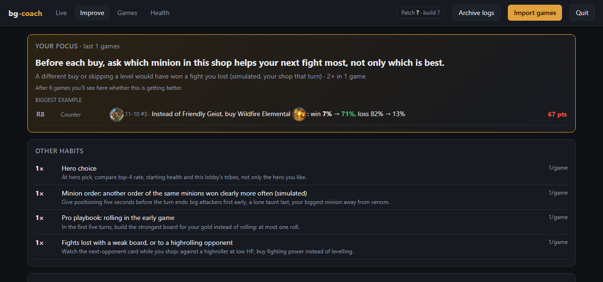
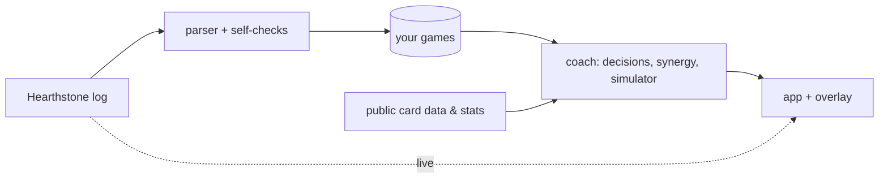

# bg-coach

A personal coach for **Hearthstone Battlegrounds**. bg-coach reads the game's own log, records
every decision you make (each buy, sell, play, refresh, level and pick), checks that record against
the game, and then shows you the specific moments you could have played better, with the numbers
behind them.

It is not a bot and it doesn't play for you. It helps you see your own games more clearly.

## What you get

**While you play.** A small overlay sits on top of the game: the round number, whether the
recording is healthy, and a live feed of what you did. When you pick a hero, Discover, triple
reward or Dark Gift, it shows how each option performs at your MMR, whether it fits your build,
and when two options are too close to call. During the shop phase it shows **who you fight next**:
their tier, health and triples, the last board you saw from them (and whether that was a
highroll), and, with the simulator, your current board's odds against it.

**After each game.** Between games you see one thing: the most important lesson of that game and
a habit to try in the next one (in the app and on the overlay). The game page starts with the same
lesson, then the game's story (your board strength each round; click a round to open it), then
every round in one line with its lessons underneath. The full shop, board and fight of a round, the
lobby and the card numbers are one click away. Lessons are ranked by kind, then by size: a concrete
line you could have played comes before a general habit, and a lost fight comes last. The coaching
looks at the lobby, not just your cards:
- **Counter lines** for fights you lost: what you could have done that turn with a minion still in
  your shop. For example: *"skip the 5-gold level-up and buy Tarecgosa: 0% → 42% win, simulated
  (risky: a tier lower next turn)"*, or *"instead of Southsea Busker, buy this venomous minion"*.
  When nothing in your shop would have won, it says the fight was decided earlier.
- **Highrollers**: opponents whose board was 1.5× or more the average for their hero, with what you
  had already seen of them, plus a lobby panel with every opponent's fights.
- **Minion order**: the same minions in another order, simulated (rounds 1–10).
- **Hero choice**, explained: top-4 rate, early vs late strength, how this lobby's tribes suit each
  hero, and the hero power. Plus **risky level-ups** at low health.
- **Pro playbook:** fundamentals top players teach (don't roll early, tier 3 by turn 5, don't
  level below the 15-HP damage cap, level before playing a triple reward, use your Dark Gifts…),
  flagged when you did otherwise, each with its source. The full list is in [docs/PLAYBOOK.md](docs/PLAYBOOK.md).
- **Card numbers** (buys and picks against the averages at your MMR) as background context only,
  because averages can't see your situation.

**Across games.** Your focus: the one habit that costs you the most, whether it's getting better
game by game, and its biggest example. Then your other habits, the decisions to learn from, and
your stats compared with your good and bad games and with players at your MMR, as context rather than rules.

| Live, while playing (test replay) | Across games |
|---|---|
|  |  |

*Screenshots from the anonymised test game in [`tests/fixtures`](tests/fixtures).*

## How accurate is it?

The coaching is only as good as the record, so the record checks itself:

- **Self-checks while parsing.** Every recorded buy, sell, level, play, cast and refresh must show
  its effect in the game (gold spent, card moved, tier changed). The overlay shows the running count,
  and any failure becomes a report with the exact log line.
- **Cross-checked against Hearthstone Deck Tracker.** `bgcoach check` re-parses every archived log
  and compares hero, placement and final board with HDT's own record:
  **33/33 games agree on all three** (author's archive, November 2026).
- **The simulator is validated before use.** Compared with Bob's Buddy on real fights it agrees
  within about 2 percentage points for rounds 1–5 and 10 points for rounds 6–10, so it is only used
  up to round 10, and only for fights it reproduces.

How the log is read, and the coaching rules: [docs/ARCHITECTURE.md](docs/ARCHITECTURE.md).

## Install

Download **`bg-coach-<date>.zip`** from the [latest release](https://github.com/KoSweet/bg-coach/releases/latest)
and unzip it somewhere permanent (or `git clone` this repository).

### Windows
1. Install [uv](https://docs.astral.sh/uv/) (one line in PowerShell:
   `powershell -ExecutionPolicy ByPass -c "irm https://astral.sh/uv/install.ps1 | iex"`).
2. Double-click **`bg-coach.vbs`**. The first start installs everything (about a minute) and creates
   a **bg-coach** shortcut on your Desktop and in the Start menu.
3. **Restart Hearthstone once** so its logging is switched on. From then on, use the shortcut.
   No console window.

### macOS
1. Double-click **`mac/setup.command`** (if macOS blocks it: right-click → Open, or run
   `bash mac/setup.command` in Terminal). It installs uv and Python, turns on Hearthstone's
   logging, and creates **`bg-coach.app`**.
2. **Restart Hearthstone once.** From then on, start **bg-coach.app** (drag it to your Dock).

**Optional:** install [Node.js](https://nodejs.org) before setup to enable the combat simulator
(minion order and "what if" fight checks). Everything else works without it.
[Hearthstone Deck Tracker](https://hsreplay.net/downloads/) (Windows) adds Bob's Buddy odds and your MMR.

## Use

- Start bg-coach, then play. Run Hearthstone **windowed or fullscreen-windowed** so the overlay
  can show on top. Click the round icon for the live feed; `–` shrinks it; `✕` opens a menu (quit).
- Something looks wrong mid-game? Press **Print Screen**. The screenshot is attached to that round;
  after the game, open the game's page → 📷 → ⚑ **Report this**.
- **Improve**: what to work on, biggest first. **Games**: every game with its timeline and coach.
  **Health**: errors and data checks. **Quit** (top right) stops recording.
- Keep the app open while you play: it keeps its own copy of the log, because Hearthstone can
  empty the log file when it exits.

## Privacy

Everything runs on your computer and your games are never uploaded. bg-coach only downloads
public data: card data and art from [HearthstoneJSON](https://hearthstonejson.com), public
Battlegrounds statistics from [Firestone](https://www.firestoneapp.com), and the current card pool
from Blizzard's public card API. Reports you copy from the app have BattleTags, player names and
your folder names removed.

## Fair play

bg-coach works like other trackers such as Hearthstone Deck Tracker and Firestone: it **reads the log
file Hearthstone writes** when logging is switched on. It never changes game files, reads game
memory, talks to the game or Blizzard's servers, or plays for you. Live, it only shows what you have
seen yourself (your shop, your fights, the leaderboard) plus public statistics. Blizzard doesn't
formally endorse third-party tools and forbids automation and game-file changes, which bg-coach
doesn't do. Tournaments can set their own rules: check them before using any tracker there.

## Reporting a problem

Use **Copy report** in the app (Health tab, or ⚑ on a round) and paste it into a
[bug report](https://github.com/KoSweet/bg-coach/issues/new?template=bug_report.yml). If a log is
needed, anonymise it first: `uv run bgcoach anonymise "path/to/Power.log" --game 2`.

## Commands

Everything the app does is also available as `uv run bgcoach <command>`:

| Command | What it does |
|---|---|
| `ui` | Open the app and overlay (`--test` replays a recorded game, `--port`, `--no-overlay`) |
| `setup` | Check where Hearthstone is, switch on its logging (`--shortcut`: Windows shortcuts) |
| `log [FILE]` | Print a game as a readable timeline (`--live` follows the running game) |
| `import` / `archive` | Parse archived logs into games / copy new logs into the archive |
| `check` | Re-parse the archive and compare with HDT's records |
| `whatif` / `sim-check` | Run the simulator on recent games / validate it against Bob's Buddy |
| `facts` | Verified facts about your last session (for a coaching chat in Claude Code) |
| `anonymise LOG` | Make a log safe to share |
| `version` | Game build, patch and the current card pool |
| `share` | Build a clean zip of the program (no personal data) |

## Limits

- Bob's Buddy odds and MMR come from Hearthstone Deck Tracker (Windows only); without it those
  parts are empty and statistics use all players.
- Card and hero numbers are correlations from players at your MMR, not rules. You may have had a
  plan that the numbers don't see.
- The simulator doesn't know hero powers, trinkets or hidden scaling, so it's used for rounds 1–10.
- Duos are recorded, but the coaching assumes solos.
- macOS support is new: tested by simulation, not yet on many real Macs. Reports are welcome.

## Troubleshooting

- **No games appear:** run `uv run bgcoach setup`. It shows where it looks for Hearthstone
  (set `BGCOACH_HS_DIR` if it is installed somewhere unusual). Then restart Hearthstone.
- **App output:** `data/app.log`. On Windows, `bg-coach-debug.bat` runs with a visible console.
- **Try it without playing:** `bg-coach-test.bat` or `uv run bgcoach ui --test` replays a recorded game.

## Contributing

Bug reports from real games help most. To work on the code, see [CONTRIBUTING.md](CONTRIBUTING.md):
`uv sync`, `uv run pytest`, and the tests run on Windows, macOS and Linux in CI.

## Credits

Card data: [HearthstoneJSON](https://hearthstonejson.com). Statistics and the combat simulator:
[Firestone](https://github.com/Zero-to-Heroes) (the simulator is installed locally for personal use
under its own licence and isn't part of this repository). Bob's Buddy odds and game history:
[Hearthstone Deck Tracker](https://github.com/HearthSim/Hearthstone-Deck-Tracker).

bg-coach is a free, non-commercial fan project, not affiliated with or endorsed by Blizzard
Entertainment. Hearthstone® is a trademark of Blizzard Entertainment, Inc. Card names, card art and
hero art are © Blizzard Entertainment, Inc. This repository doesn't contain card art: the app
downloads it from HearthstoneJSON to your computer when you use it. The screenshots above show it
under Blizzard's terms for non-commercial fan use.

The code is licensed under the [MIT licence](LICENSE). That licence covers bg-coach's own code
only, not Blizzard's names, art or game data.
