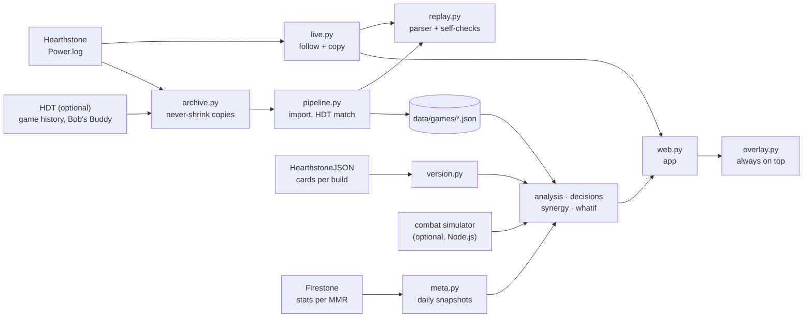

# How bg-coach works

bg-coach turns Hearthstone's own game log into a verified record of every decision you made,
then compares those decisions with what else was possible at that moment. This page is for
contributors and the curious; the [README](../README.md) covers installing and using it.

## Principles

1. **Facts before advice.** A game record is only useful if it is right. The parser checks itself
   against the game while it reads (self-checks), and the whole archive is cross-checked against an
   independent record (Hearthstone Deck Tracker) with `bgcoach check`.
2. **Decisions, not slogans.** Coaching points at a moment ("round 6: this order wins 29% instead
   of 6%") with the numbers behind it. Population statistics are shown as context, never as rules.
3. **Never suggest an off-build card.** A card that is "better on average" but doesn't fit what you
   are building is not an alternative (see [Synergy](#synergy)).
4. **Local and private.** Games, logs and screenshots stay on your computer. Only public card data
   and public statistics are downloaded. Anything meant for sharing (bug reports, test fixtures) is
   anonymised first.

## Pipeline



| Module | Role |
|---|---|
| `paths.py` | Every location on Windows and macOS; overridable with `BGCOACH_*` environment variables |
| `version.py` | Game build → patch name; card database for the exact build (cached) |
| `archive.py` | Copies Hearthstone/HDT logs into `data/raw` (Hearthstone keeps only a few sessions) |
| `replay.py` | `Power.log` → `Game`: rounds, shops, every action, choices, fights, placement; emits events |
| `live.py` | Follows the running game's log, emits events to the app, keeps its own copy of the log |
| `pipeline.py` | Imports archived logs into `data/games/*.json`, matches HDT's records, `verify_against_hdt` |
| `health.py` | Error log, per-game data checks, privacy-safe problem reports |
| `meta.py` | Firestone hero/card statistics per MMR bracket, snapshotted daily |
| `analysis.py` | Per-game coach section and the cross-game "what to work on" report |
| `advice.py` | When an alternative is really better: fit, beyond chance, survival at low HP (all suggestions) |
| `decisions.py` | Moments to review: hero, fights (with the matchup), counter lines, minion order, risky levels; card numbers as context |
| `lobby.py` | The lobby as you saw it: your board vs the boards you fought (head to head), opponent boards vs the lobby around that round (highrollers), tribes, leaderboard each round |
| `situation.py` | The game at one decision, the way a pro reads it: next opponent (tier, form, last board), your board vs the lobby, health vs the damage cap, the tier race, what the next tier holds for your tribe; weighs reasons for and against a level |
| `playbook.py` | Principles from top players' guides, checked against each game (see docs/PLAYBOOK.md) |
| `lessons.py` | Ranks a game's moments into lessons (the one thing + a habit), shared by the game page, after-game card, overlay and Improve |
| `synergy.py` | How well a card fits the build at that moment |
| `combat_sim.py`, `whatif.py`, `simcheck.py` | Combat simulator bridge, cached what-ifs, validation vs Bob's Buddy |
| `bobsbuddy.py` | Bob's Buddy win/tie/loss odds per fight, read from HDT's log |
| `web.py`, `static/index.html` | The app: local HTTP server (standard library only) + one-page UI, live via server-sent events |
| `overlay.py` | Small always-on-top Tk window: round, status, live feed, pick advice |
| `screenshots.py` | Hearthstone screenshots (Print Screen) attached to the round they were taken in |
| `anonymise.py` | Strips names and account ids from a log |
| `cli.py`, `terminal.py`, `install.py`, `share.py`, `facts.py` | Commands, terminal timeline, first-run setup, shareable zip, session facts |

## Reading the log

Hearthstone writes every game event to `Logs/Power.log` once logging is enabled
(`bgcoach setup` writes the required `log.config`). The parser reads only `GameState.` lines.

- **What you did.** `DebugPrintOptions` lists every legal option at that moment; `SendOption`
  says which one you chose (with target and position). The option's card id names the action:
  `TB_BaconShop_DragBuy` (buy), `…DragSell` (sell), the reroll and freeze buttons, tavern-up,
  Dark Gift, hero power; a minion in hand means play. Zone-change heuristics are not used.
- **What you picked.** `DebugPrintEntityChoices` + `DebugPrintEntitiesChosen`: hero pick,
  Discovers, triple rewards, trinkets, Dark Gifts.
- **Rounds.** Round = (TURN + 1) // 2; odd turns are the shop phase, even turns the fight.
- **Who you are.** The player with a real Battle.net account (`GameAccountId lo != 0`). Bob is a
  separate player whose minions fill the shop; spectated games belong to another account and
  are kept apart.
- **Gold** = RESOURCES + TEMP_RESOURCES − RESOURCES_USED.
- **Fights.** Result from `BACON_WON_LAST_COMBAT` plus the change in health + armor; damage dealt =
  the highest PREDAMAGE on the opponent's combat hero.
- **Placement** = the last `PLAYER_LEADERBOARD_PLACE` on your hero (or the copy created when you
  die) *before* `STATE=COMPLETE`. Values after that are a cosmetic re-sort.

Things learned the hard way, each covered by a test:

- Clicking a shop card only selects it; buys are only drag-buy options (0 of 147 clicks bought anything).
- Hearthstone can **empty `Power.log` when it exits**. The archiver never replaces an archived file
  with a smaller one (a shorter new log becomes a separate version), and the live watcher writes its
  own compressed copy as the game happens.
- HDT stamps a game when *it* notices it, so games are matched by hero within 20 minutes.

### Self-checks

Every recorded buy, sell, level, play, cast and refresh registers the effect it must have on the
game (gold spent, card moved, tier changed…), verified when the next options arrive. A failure
means the parser recorded something the game didn't do, and becomes an error with the log line.
Clicks that land just as the turn timer ends are real but have no effect; they are marked
`applied: false`. The overlay shows the running count while you play.

## Coaching

**Statistics** come from Firestone's public Battlegrounds data per MMR bracket (top 100/50/25/10/1%),
for your bracket when your rating is known (from HDT), otherwise all players. Card numbers are
per round played: "average final placement of players at your MMR who played this card on this
round". They are correlations from hundreds of thousands of games, not rules, and need at least
150 games to be used.

**When is another option really better?** (`advice.py`, shared by every suggestion, post-game and live)

1. **Fit**: it fits your build at least as well as your choice, and is never off-build ([Synergy](#synergy)).
2. **Evidence**: it averages at least 0.25 places better *and* the difference is beyond chance:
   more than two standard errors, computed from how many games each average rests on (placements
   spread over 1–8 have a standard deviation of about 2.29). Two cards seen 150 times each must be
   over 0.5 places apart; cards seen thousands of times only need the 0.25.
3. **Survival**: at 15 HP or less, it must also add at least as much to your board right now
   (printed attack + health). The statistics can't see that you might die next fight, and players
   who take economy cards late are mostly the ones healthy enough to afford them.

Live, the same rules mark a pick as **too close to call** when the runner-up is within chance,
and at low HP name the option that adds the most to your board now.

**Moments to review** (`decisions.py`):

| Kind | Shown when |
|---|---|
| Hero | the best hero offered averages clearly better (rule 2) than the one you took; with the reasons: top-4 rate, early/late fight win rate, how this lobby's tribes suit each hero, the hero power |
| Fight / Highroller | you lost 7+ HP with a board below 90% of the boards you fought around that round, *or* to an opponent whose board was ≥ 1.5× the lobby then (yours included) and ≥ 1.25× yours ("highroller"), and Bob's Buddy didn't have you favoured. Shows their board, keywords, and when you had seen that player before |
| Counter | for a lost fight the simulator reproduces: a line with gold you had that turn and a minion still in your shop at the end of it (buy it *instead of* one you bought, *skip the level-up*, or spare gold + selling your weakest) changes the fight by ≥ 15 points (win + half the ties). Marked risky when it costs a tier or total stats. When no line works, the fight says so: it was decided earlier |
| Position | the simulator finds an order of the *same minions* that wins ≥ 10 points more often |
| Level | you levelled at 15 HP or less while your board was already below 85% of the average, then lost that fight |

**Card numbers** (context, not moments): buys and picks where another card that fit as well
averaged clearly better (rules 1–3). Averages can't see your situation (an economy card while you're
losing, a plan for next turn), so they never rank as habits; when the card you took has a
situational payoff the note says so.

**The lobby** (`lobby.py`) uses only what the game showed you: boards from your own fights and the
leaderboard (tier, health, triples) recorded every round. Live, the game announces your next
opponent during the shop phase; the app shows their last board you saw and, with the simulator,
your current board's odds against it (a floor for them: they've grown since).

### Synergy

`synergy.py` scores each option against the build at that moment:
3 = main tribe or a theme you are clearly playing (spells cast on minions, Discovers, triples…),
2 = no tribe / flexible engine, 1 = a side tribe, 0 = a tribe you don't play.
An alternative is only suggested if it scores at least as high as what you took, and never at 0.
Example (a regression test): with a Beast board, Balinda (spell engine) is a fine pick over
Hooktusk (Pirate), even though Hooktusk averages better in general.

### Combat simulator

Optional. `sim/run.js` wraps Firestone's simulator (npm `@firestone-hs/simulate-bgs-battle`,
licence "All rights reserved": installed locally with `npm install --ignore-scripts` for personal
use and never redistributed). Validated against Bob's Buddy on real fights (`bgcoach sim-check`):

| Rounds | Mean difference in win % | Same favourite |
|---|---|---|
| 1–5 | 2.1 points | 38 of 39 |
| 6–10 | 9.7 points | 39 of 44 |
| 11+ | 16.6 points | not used |

So it is used for rounds 1–10 only, and only for fights it reproduces: within 15 points of Bob's
Buddy, or the real result had ≥ 25% probability in the simulation. Hero powers, trinkets and
hidden scaling aren't passed to it.

## Data folder

Everything lives in `data/` next to the code (or `BGCOACH_DATA`), never in the repository:

```
data/
  raw/hs/<session>/Power*.log.gz   archived game logs (the irreplaceable source of truth)
  raw/hdt/                         HDT game history + logs (Windows, optional)
  raw/manifest.json                what was archived, so nothing is copied twice
  games/<start>_<hero>.json        one parsed game each (regenerable from raw/)
  imported.json                    which archived logs were parsed
  meta/<date>/*.json.gz            daily snapshots of the public statistics
  sim/<game>.json                  cached simulator results per game
  cache/                           card data, patch list, card art
  errors.jsonl, reports/           problems and flagged rounds
  app.log, overlay_pos.json        app output, overlay position
```

## Known limitations

- Duos are parsed, but the checks and coaching assume solos.
- Archiving runs while the app is open (and every 30 minutes). Keep the app open while playing:
  its live copy is what protects a game from Hearthstone emptying the log on exit.
- The overlay can't draw over exclusive fullscreen; use windowed or fullscreen-windowed mode.
- Bob's Buddy odds and HDT history exist only on Windows with HDT installed.
- The macOS build is written and tested by simulation (paths, setup), not yet on a real Mac.
